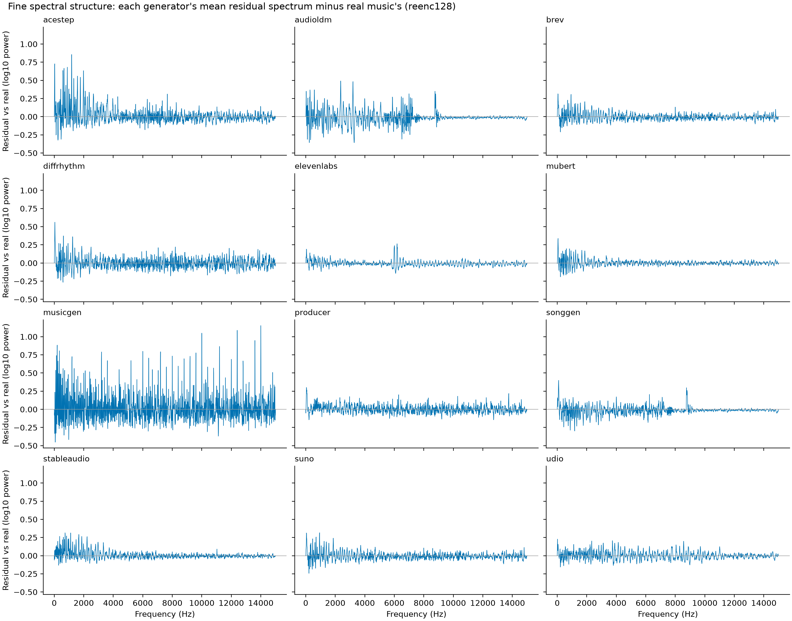
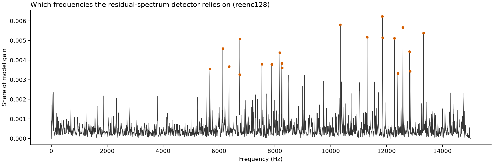
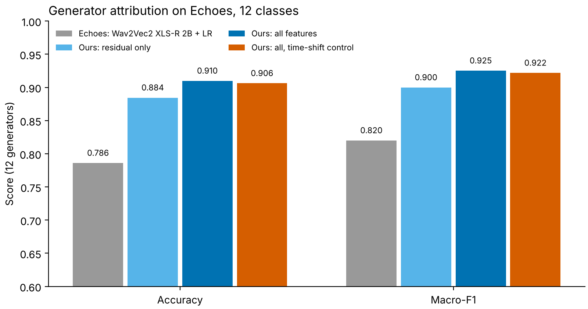
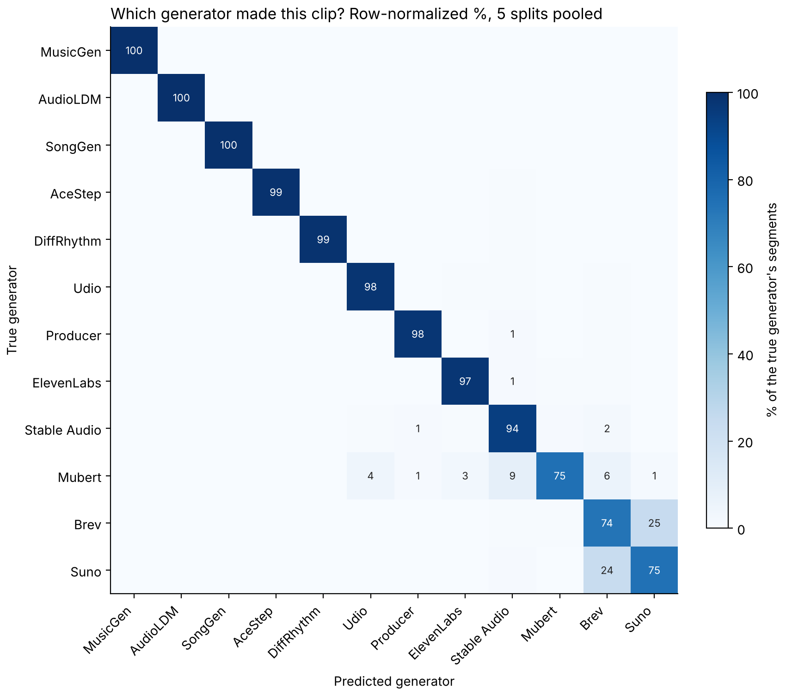
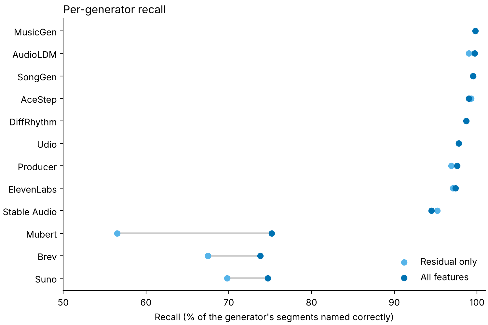
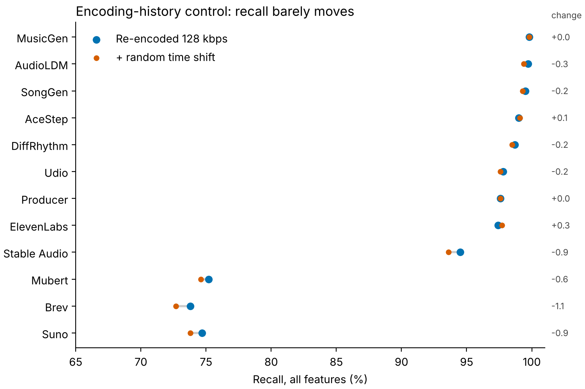

# Spectral Fingerprints of AI Music Generators

**A 2.5 MB detector that halves the published error on the Echoes benchmark.**

Project page: **https://joshuadebellis.github.io/ai-music-fingerprints/**

AI music generators leave narrow, generator-specific artifacts in the fine structure of the audio spectrum. A detector built from those artifacts, using FFT-based features and XGBoost with no neural network, reaches **8.4% segment-level EER** on [Echoes](https://arxiv.org/abs/2603.23667) (2026, 12 generators). The published baseline, a frozen 2-billion-parameter Wav2Vec2 XLS-R model with logistic regression, reaches **15.3%**. On generators held out of training, the two are at parity (22.5% vs 22.3%).

| | This detector | Echoes baseline |
|---|---|---|
| Segment EER, generators seen in training | **8.4%** | 15.3% |
| Segment EER, unseen generators (mean) | 22.5% | 22.3% |
| Attribution accuracy, 12 generators | **91.0%** | 78.6% |
| Model | XGBoost, 600 trees, 61,760 nodes | Wav2Vec2 XLS-R, ~2B parameters |
| Size | **2.5 MB** | ~8 GB (float32) |
| Time per 10 s segment, one CPU thread | **87 ms** end to end (115× real time) | GPU for practical speed |

All numbers are after re-encoding every real and AI track identically (see [The encoding confound](#the-encoding-confound)).

---

## Method

```
MP3 → 32 kHz mono → low-pass 15 kHz → 10 s segments, loudness-normalized → features → XGBoost
```

Features per 10-second segment (9,142 numbers):

| Block | Size | Description |
|---|---|---|
| Fine spectrum (LTAS) | 1,921 | Long-term average log power per 7.8 Hz bin, 0–15 kHz (FFT size 4096) |
| **Spectral residual** | 1,921 | Fine spectrum minus a median-smoothed copy: narrow peaks and dips only. **Strongest single block.** |
| MFCC statistics | 80 | Mean and std of 20 MFCCs and their deltas |
| Band-energy path signature | 5,220 | Depth-3 signature of time + lead-lag of 8 log-mel band energies over the segment |

Protocol follows the Echoes paper (10 s segments, segment-level EER), with one stricter change: train and test are split by **reference song**, so a real song and all of its AI imitations are always on the same side. Results are means over 5 random 80:20 splits.

## Results

### In-domain (generators seen in training)

| Features | Segment EER | Track EER |
|---|---|---|
| **All combined** | **0.084 ± 0.006** | **0.031** |
| Spectral residual only | 0.099 | 0.043 |
| Fine spectrum only | 0.171 | 0.098 |
| MFCC 20 statistics | 0.276 | 0.177 |
| Band-energy path signature | 0.348 | 0.225 |
| *Echoes paper: Wav2Vec2 XLS-R 2B + LR* | *0.153* | — |

### Per generator

| Generator | Seen: paper | Seen: ours | Unseen: paper | Unseen: ours |
|---|---|---|---|---|
| AudioLDM | 17.4% | **1.2%** | 27.5% | **11.4%** |
| SongGen | 12.7% | **2.4%** | 20.6% | **9.2%** |
| Suno | 13.5% | **4.2%** | 16.5% | **5.5%** |
| DiffRhythm | 9.0% | **4.2%** | 11.4% | 32.1% |
| MusicGen | 12.6% | **4.5%** | 22.8% | 30.0% |
| AceStep | 13.3% | **5.2%** | 19.4% | 28.5% |
| Brev | 13.9% | **5.2%** | 17.1% | **7.4%** |
| Producer (Riffusion) | 13.9% | **6.1%** | 18.6% | 26.6% |
| ElevenLabs | 16.7% | **6.5%** | 25.1% | 27.7% |
| Udio | 15.6% | **9.9%** | 24.9% | 31.0% |
| Stable Audio | 20.5% | **12.2%** | 31.1% | **25.7%** |
| Mubert | 21.7% | 25.8% | 33.2% | 34.8% |
| **Mean** | 15.1% | **7.3%** | 22.3% | 22.5% |

"Unseen" = leave one generator out of training and test real music vs that generator. The features are sharp but generator-specific: they learn each architecture's fingerprint, which explains the large seen-to-unseen gap.

### What gives them away



- **MusicGen:** an evenly spaced comb of spikes across the spectrum (regular at ~398 Hz), the classic trace of an upsampling or codec decoder.
- **AudioLDM, SongGen:** flat above ~7–9 kHz with a sharp edge near 8.8 kHz, consistent with a low internal sample rate.
- **ElevenLabs:** a distinctive bump near 6 kHz.
- **Suno and Brev:** the same ripple spacing (~469 Hz); each covers for the other when held out, matching the Echoes paper's attribution confusion between them.
- **Mubert:** closest to real music and hardest to catch.



### Which generator made it?

Detection asks whether a clip is AI. Attribution asks *which* AI made it. The same features and XGBoost settings, switched to 12-class, name the generator of a 10 s segment with **91.0% accuracy**. The Echoes baseline (Wav2Vec2 XLS-R 2B + logistic regression) gets 78.6%.



| Features | Segment accuracy | Macro-F1 | Track accuracy |
|---|---|---|---|
| **All combined** | **0.910 ± 0.006** | **0.925** | **0.968** |
| Spectral residual only | 0.885 ± 0.012 | 0.900 | 0.960 |
| *Echoes paper: Wav2Vec2 XLS-R 2B + LR* | *0.786* | *0.82* | — |

AI segments only, as in the paper. Same 5 splits by reference song as detection, which is stricter than the paper's track-level split. Majority-class rate 14.3% (paper: 15.1%).



- **10 of 12 generators** are named correctly at least 94.5% of the time. MusicGen, AudioLDM and SongGen are above 99%.
- **Suno and Brev** are mistaken for each other about 24% of the time each way, which is almost all of the remaining error. They share the ~469 Hz ripple above, and the Echoes paper reports the same pair at 26–27%.
- **Mubert** is named correctly 75% of the time. Its misses spread across Stable Audio, Brev, Udio and ElevenLabs.



**Model or encoding?** Re-encoding equalizes the final bitrate but not each track's compression history, and repeated MP3 compression leaves fine-spectrum traces. As a control, every track was trimmed by a random 144–432 samples (mod the 576-sample MP3 granule) before re-encoding, so frame grids cannot line up. The pass rule was fixed in advance: beat the paper on both metrics, and drop by less than 2 points under the shift.

| Audio | Segment accuracy | Macro-F1 |
|---|---|---|
| All re-encoded, 128 kbps | 0.910 | 0.925 |
| Same, with a random time shift first | **0.906** | **0.922** |



Accuracy dropped by 0.4 points, and no generator moved by more than 1.1. ElevenLabs and MusicGen, the two with the most unusual encoding histories, did not drop at all. The fingerprints belong to the generators. This fits [Afchar et al. (ISMIR 2025)](https://arxiv.org/abs/2506.19108), who show that upsampling layers leave spectral peaks set by the architecture rather than by training data.

**Caveats.** Attribution is closed-set: it assumes the clip comes from one of the 12. Echoes holds one version of each service (for example Suno v5, Brev v4.5 Pro), so a fingerprint identifies that version, and transfer to later releases is untested.


| 10 | `attribution.py` | 12-generator attribution on the re-encoded features | ~30 min |
| 11 | `reencode_shift.py`, then `prep_hifi.py`, then `attribution.py` | Encoding-history control: random sub-frame shift before re-encoding | ~1 h |
| 12 | `fig_attribution.py` | Attribution figures | 10 s |


<!-- README.md, BLOCK D: add to the end of "Commands (PowerShell)". -->
```powershell
uv run python attribution.py cuda feat_reenc attr_reenc; if ($?) { uv run python reencode_shift.py }; if ($?) { $env:SEGMENTS_FILE="data/segments_reenc_shift.parquet"; $env:FEAT_PREFIX="feat_reenc_shift"; uv run python prep_hifi.py; $ok=$?; Remove-Item Env:SEGMENTS_FILE, Env:FEAT_PREFIX; if ($ok) { uv run python attribution.py cuda feat_reenc_shift attr_reenc_shift attr_reenc } }; if ($?) { uv run python fig_attribution.py }
```
## The encoding confound

Echoes does not ship the real audio; it is rebuilt from the Free Music Archive. The two sides arrive encoded very differently:

| Source | Typical MP3 bitrate |
|---|---|
| Real (FMA) | 256–320 kbps (median ~306) |
| Most generators | 128 kbps |
| ElevenLabs | 192 kbps |
| MusicGen | ~512 kbps (near-uncompressed) |

File bitrate **alone** separates real from AI with AUC 0.84. Every track was therefore re-encoded through the same MP3 encoder at the same settings and the whole pipeline rerun:

| Audio | Segment EER | Track EER |
|---|---|---|
| Original files | 0.071 | 0.025 |
| **All re-encoded, 128 kbps CBR** | **0.084** | **0.031** |
| All re-encoded, 96 kbps CBR | 0.093 | 0.041 |

Encoding accounted for 1–2 points; the rest is the generators. **Anyone benchmarking on Echoes with real audio rebuilt from FMA should equalize encoding first.**

## What didn't work

- **MFCC path signatures** (13 MFCCs, 10–30 s windows, depth 2–4, RF/XGBoost/logistic regression): best ~0.33 segment EER. Signatures beat MFCC averages by about 6 points under a linear model, but 13 MFCCs blur the fine spectral detail that matters.
- **Chroma path signatures:** ~0.43. Frame-level pitch paths carried little signal on these generators.
- **Longer windows** (20 s, 30 s): ~1 point of improvement.
- **Zero-padding short clips to a fixed length is a shortcut.** With padding, the generators whose clips are shorter than the window become trivially detectable (MusicGen and SongGen drop to ~9% EER) because the model sees where the silence starts. All reported results use full-length windows only.

## Reproduce

Tested on Windows 11 with a 32-thread CPU and an NVIDIA GPU (CUDA 12), Python managed by [uv](https://docs.astral.sh/uv/). Disk: ~35 GB in `data/`.

```powershell
uv sync
```

`evaluate_features.py` runs on CPU (`cpu`) or GPU (`cuda`). `lopo.py`, `bitrate_check.py`, `importance.py` and `timing.py` use the GPU via CuPy.

### Pipeline (run order)

| Step | Script | What it does | Time |
|---|---|---|---|
| 1 | `download_echoes.py` | Download and extract Echoes (8.6 GB zip, 4,468 AI tracks) | 15–45 min |
| 2 | `match_fma.py` | Match the 296 real reference songs to FMA track IDs via `tracks.csv` (296/296 exact) | 1 min |
| 3 | `fetch_fma_tracks.py` | Pull only those tracks out of the 879 GB `fma_full.zip` with HTTP range requests (~2.4 GB) | 5 min |
| 4 | `prep_audio.py` | Cut 10 s segments (first 18 per track) → `data/segments.parquet` (46,185 segments) | 8 min |
| 5 | `reencode.py [kbps]` | Re-encode every track identically (LAME CBR, 44.1 kHz stereo) | 6 min each |
| 6 | `prep_hifi.py` | Spectral, MFCC and signature features | 5 min |
| 7 | `evaluate_features.py` | In-domain evaluation, 5 splits by reference song | 8 min |
| 8 | `lopo.py` | Leave-one-generator-out | ~75 min |
| 9 | `bitrate_check.py`, `importance.py`, `timing.py` | Encoding control, fingerprints, speed and size | 5 min |

### Commands (PowerShell)

```powershell
uv run python download_echoes.py; if ($?) { uv run python match_fma.py }; if ($?) { uv run python fetch_fma_tracks.py }; if ($?) { uv run python prep_audio.py }; if ($?) { uv run python reencode.py 128 }; if ($?) { uv run python reencode.py 96 }
```

Features on the original files (needed for the bitrate check) and on both re-encoded sets:

```powershell
uv run python prep_hifi.py; $env:SEGMENTS_FILE="data/segments_reenc.parquet"; $env:FEAT_PREFIX="feat_reenc"; uv run python prep_hifi.py; $env:SEGMENTS_FILE="data/segments_reenc96.parquet"; $env:FEAT_PREFIX="feat_reenc96"; uv run python prep_hifi.py; Remove-Item Env:SEGMENTS_FILE; Remove-Item Env:FEAT_PREFIX
```

Evaluation, controls and figures:

```powershell
uv run python evaluate_features.py cuda reenc xgb ltas=data/feat_reenc_ltas.npy ltas_resid=data/feat_reenc_ltas_resid.npy mfcc20_stats=data/feat_reenc_mfcc20_stats.npy band_sig=data/feat_reenc_band_sig.npy all=data/feat_reenc_ltas.npy+data/feat_reenc_ltas_resid.npy+data/feat_reenc_mfcc20_stats.npy+data/feat_reenc_band_sig.npy; if ($?) { uv run python lopo.py }; if ($?) { uv run python bitrate_check.py }; if ($?) { uv run python importance.py data/feat_reenc_ltas_resid.npy reenc128 }; if ($?) { uv run python timing.py }
```

On macOS or Linux, replace `$env:NAME="value"; ...` with `NAME=value uv run python ...`.

### Repository layout

```
download_echoes.py, match_fma.py, fetch_fma_tracks.py   data acquisition
prep_audio.py, reencode.py, prep_hifi.py                segmentation, encoding control, features
evaluate_features.py, lopo.py                           evaluation
bitrate_check.py, importance.py, timing.py              controls, fingerprints, speed
exploratory/                                            earlier experiments (MFCC/chroma signatures, windows, 30 s baseline)
results/                                                CSV results and the trained detector (detector_reenc128.ubj)
figures/, docs/                                         figures and the project page
```

## Limitations

- **Unseen generators remain hard:** parity with the baseline, not a win.
- **Mubert** is barely detectable by either approach.
- **One dataset** with 296 real songs; each test split contains ~60 real songs, hence the 5-split averages.
- The split by reference song is slightly stricter than the paper's, so comparisons are, if anything, conservative.
- Spectral fingerprints may fade as generators improve their decoders or deliberately suppress artifacts.

## Data and credits

- **Echoes:** Pascu, Oneata, Cucu, Müller. *Echoes: A semantically-aligned music deepfake detection dataset.* arXiv:2603.23667 (2026). CC-BY-SA. [Hugging Face](https://huggingface.co/datasets/Octavian97/Echoes)
- **FMA:** Defferrard, Benzi, Vandergheynst, Bresson. *FMA: A Dataset for Music Analysis.* ISMIR 2017. [GitHub](https://github.com/mdeff/fma)

No audio is redistributed in this repository. Audio remains under its original licenses.

## License

- **Code:** [PolyForm Noncommercial 1.0.0](https://polyformproject.org/licenses/noncommercial/1.0.0). Free for research, education and personal use; commercial use requires a separate license.
- **Text and figures:** [CC BY-NC 4.0](https://creativecommons.org/licenses/by-nc/4.0/).

For commercial licensing, contact the author.

## Author

Joshua DeBellis,  mathematical physicist and data scientist.
